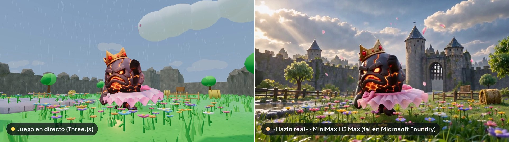

# Plató · Plataformas 3D

**Un juego de plataformas en 3D que se supera hablando, con modelos de Microsoft Foundry y GitHub Copilot.**



Rubio no puede llegar solo a la meta: cada obstáculo se supera cambiando el nivel con una orden. Una escalera para el
muro, un charco con un tiburón que se come al enemigo, un puente, cinco compañeros que deciden cómo ayudarte, un jefe
final que pasa de lanzar bolas de fuego a lanzar flores (y baila con tutú)… y «hazlo real» convierte una toma del juego
en vídeo mientras sigues jugando.

Cada orden la enruta **Microsoft-Decision-1.1**, y el panel del router (tecla <kbd>I</kbd>) enseña qué decidió, con qué
probabilidad, en cuántos milisegundos y qué modelo respondió. Todo funciona con **tus sesiones de Azure y de GitHub**,
sin claves en el código ni en el navegador.

> **In English:** Plató · 3D Platformer is a 3D platform game you beat by talking. MAI-Transcribe-2-Streaming hears
> you, Microsoft-Decision-1.1 routes every order, GPT-6 Luna (or GPT-6.2 Astra) turns it into level changes,
> MAI-Code-2-Flash (through the GitHub Copilot SDK) writes new 3D objects live, MAI-Voice-2.1-Flash gives every
> character a voice, and MAI-Image-2.7 + MiniMax H3 Max (fal on Microsoft Foundry) turn a gameplay shot into film.
> The whole game also runs in English: open `http://localhost:8740/?lang=en` (see [English mode](#modo-inglés-english-mode)).

## Qué hace

| Momento | Qué pasa | Modelos |
|---|---|---|
| Dices una orden (o la escribes) | Decision-1.1 decide en ~150 ms si es directa o necesita razonar, y si es apta para una demo pública; el modelo elegido la convierte en operaciones JSON sobre el nivel | Microsoft-Decision-1.1 → GPT-6 Luna (sin razonamiento) o GPT-6.2 Astra |
| Pides algo que no está en el catálogo | El código aparece en el panel mientras se escribe, se ejecuta en un Web Worker sin red y Decision-1.1 mira una captura para comprobar que se parece a lo pedido | Decision-1.1 → MAI-Code-2-Flash (o GPT-6.2 Astra si es una pieza compleja) |
| Llamas a los compañeros | Granito, Nubi, Capi, Brinca y Pipo deciden cómo ayudarte, y se ve en el panel | Microsoft-Decision-1.1 |
| Un personaje habla | Cada uno tiene siempre su voz, y la frase se dice con la emoción que toca | MAI-Voice-2.1-Flash · Decision-1.1 (emoción) |
| Mantienes <kbd>T</kbd> | Ves el texto mientras hablas y la orden se ejecuta al soltar | MAI-Transcribe-2-Streaming |
| «Hazlo real» | Un plano de cine del juego se graba del lienzo 3D; el primer fotograma se repinta y el vídeo sigue la cámara y la acción de la toma | MAI-Image-2.7 → MiniMax H3 Max (fal en Foundry), o LTX-2.5 Fast como borrador |
| Falla un modelo | Una red de seguridad local (en español y en inglés) hace igualmente todas las órdenes del guion | — |

### Por qué estos modelos (noviembre de 2026)

- **Microsoft-Decision-1.1** — 67,8 en el [AA Decision Index](https://artificialanalysis.ai/evaluations/artificial-analysis-decision-index) con 123 ms de mediana; la Decisions API de GPT-6 Luna saca 60,2 con 206 ms. Cobra solo la entrada (0,042 $ por millón de tokens).
- **GPT-6 Luna** — la opción rápida: [1,58 s al primer token sin razonamiento](https://artificialanalysis.ai/models/gpt-6-luna). En el juego, una orden tarda ~1–1,5 s en total (1,2 s de mediana en las pruebas, con Decision-1.1 incluido).
- **GPT-6.2 Astra** — n.º 1 en [AA-3D](https://artificialanalysis.ai/evaluations/aa-3d), que mide cómo construyen los modelos escenas interactivas con three.js.
- **MAI-Code-2-Flash** — el modelo de código rápido de Microsoft AI ([anuncio](https://microsoft.ai/news/introducing-mai-code-2-and-mai-code-2-flash/)). En Foundry está en acceso limitado; el juego lo usa a través de GitHub Copilot con tu cuenta.
- **MAI-Image-2.7** — n.º 1 en edición de imagen de Artificial Analysis.
- **MiniMax H3 Max** — la variante de fal de MiniMax H3, 3.º en imagen a vídeo de LMArena (4.º en Artificial Analysis); en Foundry acepta un vídeo de referencia, que es lo que permite seguir la toma 3D.
- **MAI-Transcribe-2-Streaming** — 2,5 % de error y 0,13 s hasta el texto final en el ranking de streaming de Artificial Analysis.

## Cómo se conecta

```
navegador (localhost) ──► server/ (Node, 127.0.0.1:8740)
                             ├─ Azure: tu sesión de az (o azd) ──► Microsoft Foundry: Decision-1.1, GPT-6 Luna, GPT-6.2 Astra,
                             │                                     MAI-Image-2.7, MAI-Voice, MAI-Transcribe, fal (MiniMax, LTX)
                             └─ GitHub: tu sesión de Copilot (o gh) ──► MAI-Code-2-Flash
```

Los tokens nunca llegan al navegador: el servidor solo escucha en `127.0.0.1` y solo atiende a su propia página. El
código que escriben los modelos se ejecuta en un Web Worker sin red. Más detalles en [SECURITY.md](SECURITY.md).

## Puesta en marcha

Necesitas Node 22, Azure CLI con sesión iniciada (`az login`), GitHub CLI o Copilot CLI con sesión iniciada (con un plan
de GitHub Copilot) y `ffmpeg` (para «hazlo real»).

```bash
git clone https://github.com/jrubiosainz/Plato-Foundry.git && cd Plato-Foundry
npm install
npm run provision     # crea rg-plato-dev en Sweden Central: Foundry, modelos y tu rol. Escribe config/local.json
npm start             # construye la página y arranca http://localhost:8740
```

Abre http://localhost:8740 (en inglés, http://localhost:8740/?lang=en).

`scripts/provision.sh` despliega `infra/main.bicep`: un recurso de Foundry solo con Entra ID, los despliegues de
Decision-1.1, GPT-6 Luna, GPT-6.2 Astra, MAI-Image-2.7, MiniMax H3 Max y LTX-2.5 Fast, y el rol Cognitive Services User
para ti. MAI-Transcribe-2-Streaming tiene poca cuota por suscripción; si ya lo tienes desplegado en otro recurso, el
script lo reutiliza (sin él, el juego funciona igual escribiendo las órdenes):

```bash
PLATO_STT_ACCOUNT=<recurso con MAI-Transcribe-2-Streaming> PLATO_STT_DEPLOYMENT=mai-transcribe-2-streaming npm run provision
```

Los modelos de fal necesitan la característica en vista previa `Microsoft.CognitiveServices/Fal.EnableDeploy` registrada
en la suscripción.

| Variable | Qué cambia |
|---|---|
| `PLATO_RESOURCE_GROUP` · `PLATO_LOCATION` | grupo de recursos (`rg-plato-dev`) y región (`swedencentral`) de `npm run provision` |
| `PORT` | puerto del servidor (`8740`) |
| `PLATO_CODE_MODEL` | modelo de código de GitHub Copilot (`mai-code-2-flash`) |
| `PLATO_VIDEO_RES` | resolución de MiniMax H3 Max (`768P`) |

## Cómo se juega

| Tecla | Qué hace |
|---|---|
| <kbd>W</kbd> <kbd>A</kbd> <kbd>S</kbd> <kbd>D</kbd> o flechas | moverse (relativo a la cámara) |
| <kbd>Espacio</kbd> | saltar (más alto si lo mantienes) |
| <kbd>Mayús</kbd> | correr |
| ratón (arrastrar) · rueda | girar la cámara · acercar o alejar |
| <kbd>T</kbd> (mantener) | hablar (MAI-Transcribe-2-Streaming); al soltar se ejecuta la orden |
| <kbd>V</kbd> | escucha continua: cada frase se ejecuta al terminarla |
| <kbd>Enter</kbd> o <kbd>/</kbd> | escribir una orden |
| <kbd>H</kbd> · <kbd>I</kbd> · <kbd>M</kbd> | ayuda · panel del router · sonido y voces |
| <kbd>R</kbd> · <kbd>Esc</kbd> | volver al último punto de control · cerrar la ayuda o salir del plano final |

### Guion de la demo (frases exactas)

El nivel tiene seis tramos: prado → paso del Gruñón → el muro → cañón de Refunfuño → arena del Rey Volcán → meta.

1. Ante el guardián del paso de piedra: «**elimina a este enemigo**».
2. Ante el muro: «**pon una escalera**» (se apoya en el muro y se sube andando hacia ella).
3. Ante Refunfuño, en el cañón: «**pon un charco bajo el enemigo**», «**pon un tiburón en el charco**» y
   «**haz que el tiburón se coma al enemigo**».
4. El tiburón muerde a quien se mete en su charco: «**pon un puente de madera que atraviese el charco de forma segura**».
5. Antes de la arena: «**añade 5 compañeros npc que me ayuden**» (Granito, Nubi, Capi, Brinca y Pipo; Decision-1.1
   decide qué hace cada uno y se ve en el panel).
6. En la arena el Rey Volcán lanza bolas de fuego que prenden la hierba, la madera y los árboles: «**que llueva**».
7. «**haz que el jefe final lance flores en lugar de bolas de fuego**» y «**ponle un tutú al jefe final**»: se le pasa
   el enfado, baila (donde baila, florece) y abre el rastrillo.
8. «**hazlo real**»: plano de cine del Rey Volcán bailando con su tutú, y MAI-Image-2.7 + MiniMax H3 Max (fal en Foundry)
   lo convierten en vídeo mientras sigues jugando (ver [Hacerlo real](#hacerlo-real)).
9. «**que salga el sol**» y, como la meta solo se abre con la princesa: «**pon a la princesa junto al personaje del
   jugador**».
10. Para cerrar: «**pon el logo de Foundry y Microsoft**» (y, si quieres, «**pon el logo de GitHub Copilot**»).

Otras que funcionan en cualquier momento: «que nieve», «que se haga de noche», «atardecer», «que salga el sol»,
«pon un muelle», «pon tres gemas», y cualquier invento («pon un dragón de gominola»). Caminos alternativos: al primer
guardián también se le puede poner un charco con tiburón (y luego el puente), y a Refunfuño eliminarlo.

## Modo inglés (English mode)

`/?lang=en` pone el juego entero en inglés y lo recuerda en el navegador (`localStorage`, clave `pf.lang`); `?lang=es`
vuelve al español, que es el idioma por defecto. En la portada hay un selector discreto «EN · ES» (recarga la página en
el otro idioma).

- **Todo lo visible**: portada («3D PLATFORMER»), ayuda, barra de órdenes, sugerencias, pistas, avisos, bocadillos,
  subtítulo de la orden, registro, tramos, carteles del nivel (texturas), victoria, plano final («Built by talking · …») y
  los paneles del router y de código (`site/plato.js` lee `window.PLATO_LANG`; por defecto `'es'`).
- **Nombres**: Rubio, Lúa, Granito, Nubi, Capi, Brinca y Pipo no cambian; Rey Volcán → *Volcano King*, Princesa Lúa →
  *Princess Lúa*, Gruñón → *Grumble*, Refunfuño → *Grouch*. Tramos: *Starting Meadow*, *Grumble’s Pass*, *The Wall*,
  *The Canyon*, *Volcano King’s Arena* y *Goal*.
- **Modelos**: el prompt del juego pide la respuesta (`say`) en inglés; MAI-Transcribe-2-Streaming recibe `lang=en`.
- **Voces** (MAI-Voice-2.1-Flash, reparto fijo con `npc.cast` en `server/voice.mjs`): Volcano King `en-GB-Harry` (la
  más grave, teatral), Princess Lúa `en-US-Olivia`, Granito `en-US-Ethan`, Nubi `en-US-Harper`, Capi `en-US-Grant`,
  Brinca `en-AU-Isla` (una canguro australiana) y Pipo `en-US-Jasper`. Decision-1.1 elige la emoción y solo se usa un
  estilo que la voz admita.
- **Red de seguridad local en inglés** (`app/platform/pf-orders.js`), con variantes (this/the, put/add/place…): todas las
  órdenes del guion funcionan aunque falle el modelo. Si una frase no encaja, se prueba también la gramática española.

Guion en inglés: «**remove this enemy**», «**put a ladder**», «**put a puddle under the enemy**», «**put a shark in the
puddle**», «**make the shark eat the enemy**», «**put a wooden bridge across the puddle**» (o «…safely»), «**add 5
companion NPCs to help me**», «**make it rain**», «**make the final boss throw flowers instead of fireballs**», «**put a
tutu on the final boss**», «**make it real**», «**make the sun come out**», «**put the princess next to the player
character**» y «**show the Foundry and Microsoft logos**» (y «show the GitHub Copilot logo»). También: «make it snow»,
«make it night», «sunset».

## Hacerlo real

Una orden («**hazlo real**», «**rueda esta escena y hazla real**», «**conviértelo en una película**»; en inglés «**make it
real**», «**film this scene and make it real**», «**turn this into a movie**») o el botón «Hacerlo real» de la cabecera:

1. Un plano de cine de 7 s alrededor de lo que hay delante (en la arena, el Rey Volcán: con tutú, baila entre las flores
   que hace brotar). Empieza de frente al personaje, gira despacio, se acerca y sube, y evita muros y la tarima.
2. Se graba **solo el lienzo 3D** (sin interfaz) con MediaRecorder: 1280×720, 30 fps, ~10 Mbit/s. En pantalla, bandas de
   cine y «REC».
3. `POST /api/real` con la descripción de la escena (personajes, acción, lugar, luz y cámara) y el estilo.
4. Mientras tanto el juego sigue: el panel del router enseña la nota con MAI-Image-2.7 → MiniMax H3 Max · fal en Foundry,
   la etapa y el tiempo, y la miniatura del primer fotograma en cuanto existe. El botón cuenta el tiempo.
5. Al terminar (~1,5–2 min) se abre la comparación juego ↔ vídeo generado, lado a lado o con cortinilla, en bucle y sin
   sonido (botón «Sonido del vídeo»: MiniMax H3 trae audio), con «Descargar vídeo», «Descargar toma» y <kbd>Esc</kbd>.

Nunca se generan dos a la vez: repetir la orden o pulsar el botón durante un trabajo no lanza otro.

**Estilo** (`style` en el JSON de `X-Plato-Job`, `server/video.mjs`): `'animated'` (por defecto: metraje de película de
animación 3D de gran estudio, con materiales ricos, luz de cine y sin aspecto low-poly, que conserva el diseño de cada
personaje, la cámara y la acción) o `'live'` (imagen real fotorrealista). Cada estilo tiene su prompt para la edición del
primer fotograma y para el vídeo.

**API para grabar un vídeo de producto** (consola o Playwright):

| llamada | qué hace |
|---|---|
| `PF.real.start({ style, mode, secs, target, prompt, open, dry })` | rueda y genera; devuelve una promesa que se cumple con el estado final. `style`: `'animated'` (defecto) o `'live'`; `mode`: `'reference'` (MiniMax H3 Max) o `'draft'` (LTX-2.5 Fast); `secs`: 3–10 (7); `target`: id de lo que se rueda; `open: false` no abre la comparación; `dry: true` solo graba la toma (ensayo, sin coste) |
| `PF.real.state()` | `{ phase, stage, label, id, secs, takeSecs, video, frame, take, style, mode, prompt, model, error, open, busy }`; `phase`: `idle`, `shooting`, `uploading`, `generating`, `done`, `recorded` (ensayo) o `error` |
| `PF.real.close()` · `PF.real.open()` · `PF.real.view('side' \| 'wipe')` | cerrar, reabrir y cambiar la comparación |
| `PF.real.show(id)` | reabre la comparación de un trabajo ya generado (`out/jobs/<id>`), también tras reiniciar el servidor; sin coste |

Eventos: `PF.on('real', (s) => …)`, con `s.event` = `shoot` → `recorded` → `submitted` → `stage` (una por etapa:
`prep`, `image`, `submit`, `queue`, `render`, `download`) → `frame` → `done` → `open` → `view` · `close`, o `error`; `s`
lleva el estado completo. Cada trabajo queda en `out/jobs/<id>/` (`input.*` es la toma, `real-first.png` el fotograma
generado, `real.mp4` el vídeo y `job.json` el estilo y el prompt).

## El reparto y los assets

El reparto inicial (protagonista, jefe, princesa y enemigo) son GLB generados con Magnific, que el juego carga en
segundo plano; el nivel arranca al momento con un modelo de código de respaldo para cada uno. Todo lo que aparece
durante la partida por una orden (escalera, charco, tiburón, puente, tutú, flores, compañeros, logos, confeti e
inventos) se construye con código.

`app/assets/platform/manifest.json` declara, por id (`hero`, `boss`, `princess`, `enemy`, y también `castle` y `wall`):

| campo | qué es |
|---|---|
| `file` | GLB relativo a `app/assets/platform/` (o `null`: solo el modelo de código) |
| `sourceHeight` · `height` | altura natural del GLB y altura en el juego, en metros (se escala por `height / sourceHeight`) |
| `rotateY` | corrección de la orientación en radianes (el GLB debe mirar a +Z con los pies en y = 0) |
| `animations` | estado del juego → nombre del clip: `idle`, `walk`, `run`, `jump`, `fall`, `climb`, `cheer`, `dance`, `throw`, `angry`, `wave`, `victory`, `heart`, `hit` |
| `clipFrom` · `walkSpeed` · `runSpeed` | segundo en que empieza un clip y velocidades (m/s) a las que van los ciclos que andan en el sitio |
| `glow` · `glowIntensity` | brillo de la textura (la lava del jefe y del enemigo) |
| `origin` · `license` | de dónde sale y con qué licencia |

Escala actual: protagonista 1,5 m, princesa 1,4 m, enemigo 0,8 m y jefe 3,75 m. Si un GLB no trae esqueleto ni
animaciones, se anima por código (rebote, inclinación, estirar y encoger, giros). `?glb=0` en la URL fuerza los
modelos de código y `?glb=hero:models/otro.glb:1.5` prueba un GLB sin tocar el manifiesto.

El nombre y los colores del protagonista están en `PF.HERO` (`app/platform/pf-core.js`).

## Pruebas

```bash
npm run smoke                       # cada modelo de Foundry con tu sesión (la voz se guarda en out/smoke, no suena)
PORT=8741 npm start                 # en otra terminal: el servidor de las pruebas (PLATO_URL, por defecto http://127.0.0.1:8741)
npm test                            # la API: tareas «plat» y «plat-invent» del router, reparto de voces inglés y voz a texto
npm run e2e                         # el juego entero en un navegador sin ventanas: nivel, alterno, red, compañeros,
                                    # respaldo, tiempo, voz, invento, en, en-red y en-voz
npm run e2e -- nivel red            # solo esos pasos
PF_REAL=mock npm run e2e -- real    # «hazlo real» con el vídeo simulado (gratis)
npm run e2e -- real                 # de verdad: una generación (~0,7 $); guarda la toma en tests/out/real-take.*
npm test -- real                    # la misma toma en el otro estilo (STYLE=live por defecto, o animated), ~0,7 $
```

La prueba e2e supera el nivel dos veces por el router (dos caminos) y otra sin modelo (red de seguridad), y guarda
capturas en `tests/out/` y las latencias por orden en `tests/out/pf-latencias.json`. Con Microsoft Edge instalado usa
Edge sin ventana con la GPU (`--headless=new`, Metal en el Mac): mucho más rápida, y MediaRecorder graba de verdad;
`PF_BROWSER=chromium` vuelve a Chromium con SwiftShader. El audio va silenciado. El paso `en` recorre el nivel con
órdenes en inglés por el router y comprueba que no queda texto en español a la vista (DOM, carteles, tramos y nombres) y
que las voces salen en inglés; `en-red` repite la lista sin modelo y `en-voz` habla en inglés con el micrófono falso. El
paso `real` (solo si se pide) graba una toma del jefe con tutú y comprueba la nota del router, la miniatura, la
comparación y que solo hay una generación. El paso `invento` gasta una petición de MAI-Code-2-Flash.

## Costes y límites

- **fal** procesa los datos fuera de Microsoft (no aplica el DPA de Microsoft) y su cuota es de 2 peticiones por minuto
  hasta el nivel 4. MiniMax H3 Max cuesta ~0,08 $ por segundo a 768p (~0,7 $ por toma). «Hazlo real» solo se lanza
  cuando lo pides, y nunca dos a la vez.
- **GitHub Copilot**: cada pieza que se inventa y cada sesión que se calienta cuenta como petición de tu plan. Las
  sesiones y Decision-1.1 solo se mantienen calientes mientras alguien usa la página (actividad en los últimos 15
  minutos).
- **En vista previa**: MAI-Image-2.7, MAI-Transcribe-2-Streaming y los modelos de fal.
- La primera orden tras arrancar tarda unos segundos más (los modelos se están calentando).

## Siguientes pasos

- **Kling V3 Pro** para tráileres con varios planos y audio nativo (solo en East US 2).
- Desplegarlo en Azure con identidad administrada, para jugar sin un equipo local.

## Estructura

```text
app/index.html                  la página del juego
app/platform/pf-core.js         núcleo: diseño del protagonista, utilidades, entrada, tiempo de juego, sonido y partículas
app/platform/pf-models.js       modelos de código del reparto y de las piezas, animación procedural y cargador de GLB
app/platform/pf-world.js        render, cielo, hora y tiempo, luces y el nivel con sus colisiones
app/platform/pf-actors.js       entidades, protagonista, cámara, guardianes, princesa, escalera, charco, tiburón, puente…
app/platform/pf-boss.js         el Rey Volcán, el fuego que se extiende y los proyectiles (bolas de fuego, flores…)
app/platform/pf-allies.js       los cinco compañeros y sus decisiones con Decision-1.1
app/platform/pf-orders.js       órdenes: router, estado compacto, operaciones, red de seguridad (español e inglés) e inventos en un Worker sin red
app/platform/pf-real.js         «Hacerlo real»: plano de cine, grabación del lienzo, /api/real, comparación y API PF.real
app/platform/pf-finale.js       logos oficiales en 3D, confeti y plano final
app/platform/pf-ui.js           interfaz: portada, idioma, barra de órdenes, voz, bocadillos, pistas y ayuda
app/platform/pf-main.js         arranque, bucle, meta y ayudas para pruebas
app/platform/fonts.css, fonts/  Jost y DM Mono (OFL)
app/assets/platform/            manifest.json, models/*.glb y logos/*.svg
site/plato.js                   el host: panel del router, panel de código en vivo, dictado y «Hacerlo real»
site/build.mjs                  construye site/dist (copia Three.js r128 desde node_modules)
server/                         servidor local: azure, foundry, copilot, router (Decision-1.1), voice, stt, video
infra/                          Bicep del recurso de Foundry y sus modelos
scripts/                        provision.sh, smoke.mjs, probe-copilot.mjs
tests/                          platform-api.mjs y platform-e2e.mjs
docs/                           imagen del README
licenses/                       licencias de las fuentes y de Octicons
```

## Créditos y licencia

Plató nació de [Spoken World](https://github.com/ryannli/spoken-world) de ryannli (Apache-2.0): la idea de cambiar un
mundo 3D hablando, con operaciones JSON. De allí vienen también el esqueleto del build (`site/build.mjs`, `package.json`)
y las fuentes Jost y DM Mono. Este repositorio se distribuye con la misma licencia; consulta [NOTICE](NOTICE) y
[LICENSE](LICENSE).
